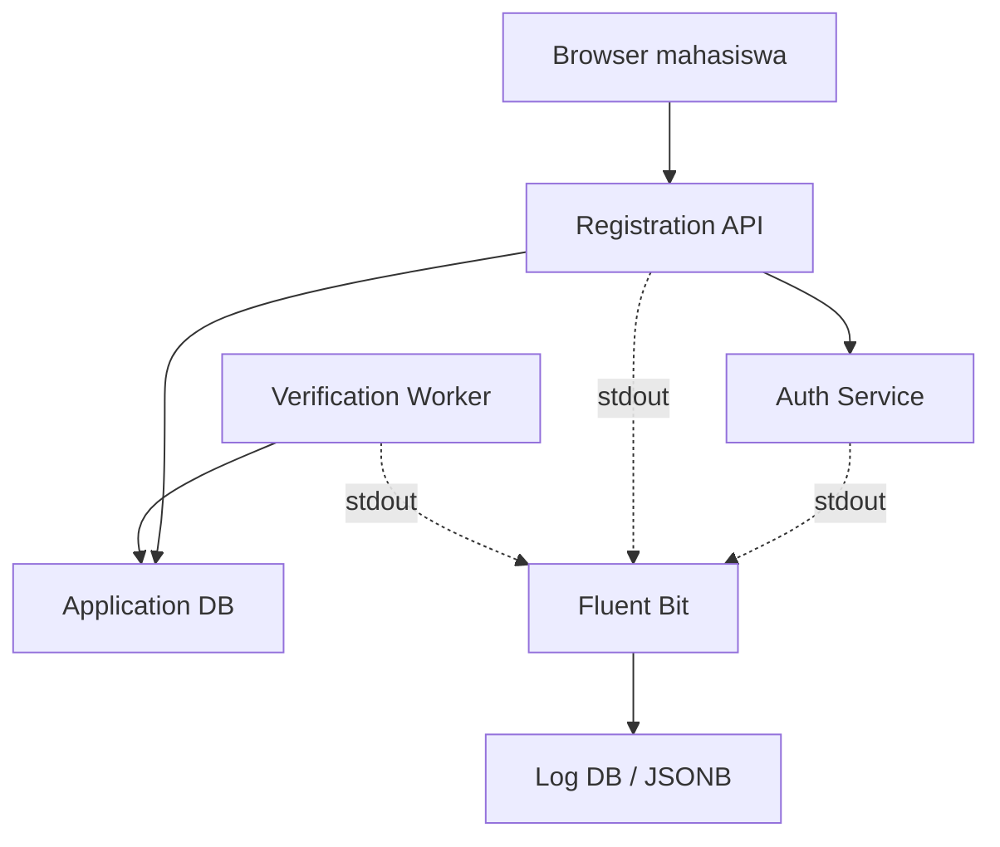

# PMB DevSecOps Laboratory

Aplikasi laboratorium Penerimaan Mahasiswa Baru (PMB) untuk Bab 6 — **Centralized Logging dengan Fluent Bit dan PostgreSQL**. Paket ini menjalankan alur transaksi nyata: pengguna login, mengirim formulir, worker memverifikasi pendaftaran, dan seluruh event aplikasi dikumpulkan dari `stdout` melalui Docker Fluentd logging driver.

> **Batas penggunaan:** seluruh akun dan data pada paket ini bersifat sintetis. Aplikasi tidak dirancang sebagai sistem PMB produksi dan tidak boleh digunakan untuk menerima data pribadi nyata.

## Capaian praktikum

Setelah menyelesaikan praktikum, mahasiswa dapat:

1. membedakan database transaksi dan backend centralized logging;
2. menghasilkan structured log tanpa membocorkan data pribadi atau credential;
3. mengorelasikan event lintas service menggunakan `request_id`;
4. merekonstruksi kronologi insiden menggunakan SQL;
5. menguji retry, timeout, buffering, recovery, dan kemungkinan kehilangan log;
6. mengumpulkan evidence yang dapat diverifikasi tanpa menyertakan secret.

## Arsitektur



| Service | Fungsi | Akses host |
|---|---|---|
| `registration-api` | UI, sesi, validasi, dan pendaftaran | `127.0.0.1:8080` |
| `auth-service` | Autentikasi internal akun lab | Tidak dipublikasikan |
| `verification-worker` | Verifikasi asinkron dan simulasi retry | Tidak dipublikasikan |
| `app-db` | Data transaksi pendaftaran | Tidak dipublikasikan |
| `fluent-bit` | Collector, buffer, dan routing log | `127.0.0.1:24224`, `127.0.0.1:2020` |
| `log-db` | Penyimpanan log `tag`, `time`, dan `data JSONB` | Tidak dipublikasikan |

## Prasyarat

- Docker Engine dengan Docker Compose v2; atau Docker Desktop dengan WSL 2.
- Bash, `curl`, dan Python 3 untuk validasi lokal.
- Sedikitnya 2 GB RAM kosong dan 3 GB storage.

Pada Docker Desktop, pastikan integrasi WSL 2 aktif dan jalankan seluruh perintah dari satu distribusi Linux yang sama.

## Quick start

```bash
cd pmb-devsecops-lab
./scripts/setup.sh
./scripts/validate.sh
docker compose up -d --build
```

Tunggu hingga service sehat:

```bash
docker compose ps
curl -fsS http://127.0.0.1:8080/healthz
curl -fsS http://127.0.0.1:2020/api/v1/health
```

Buka `http://127.0.0.1:8080` pada browser.

Credential sintetis:

```text
Username : student
Password : StudentLab!2026
```

`setup.sh` membuat `.env` dengan credential database dan session secret acak. Jangan memasukkan `.env` ke repository atau laporan.

## Skenario 1 — Alur normal

Jalankan otomatis:

```bash
./scripts/demo-normal.sh
```

Alur yang diharapkan:

```text
login_success
  → registration_submitted
  → verification_started
  → verification_completed
  → status VERIFIED
```

Atau lakukan manual:

1. Aktifkan mode normal: `./scripts/set-incident.sh none`.
2. Login ke portal.
3. Isi data sintetis dan kirim formulir.
4. Buka halaman **Status**.
5. Tunggu sampai status berubah menjadi `VERIFIED`.

## Skenario 2 — Timeout dependency

Jalankan otomatis:

```bash
./scripts/demo-incident.sh
```

Alur yang diharapkan:

```text
login_success
  → registration_submitted
  → verification_started
  → verification_retry × 3
  → dependency_timeout
  → status FAILED / VERIFY-TIMEOUT
```

Untuk menjalankan manual:

```bash
./scripts/set-incident.sh timeout
```

Kirim pendaftaran baru melalui browser, lalu kembalikan sistem ke mode normal:

```bash
./scripts/set-incident.sh none
```

Pendaftaran yang sudah `FAILED` sengaja tidak diproses ulang secara otomatis. Buat transaksi baru untuk membuktikan recovery.

## Menelusuri request ID

Setiap respons aplikasi membawa header `X-Request-ID`. Nilainya juga disimpan pada transaksi dan event log.

Tampilkan transaksi:

```bash
set -a; source .env; set +a
docker compose exec -T app-db \
  psql -U "$APP_DB_ADMIN_USER" -d "$APP_DB_NAME" \
  -c 'SELECT public_id, status, attempt, failure_code, request_id FROM registrations ORDER BY submitted_at DESC;'
```

Salin salah satu request ID, kemudian ubah variabel `investigated_request_id` pada `queries/incident-analysis.sql` dan jalankan:

```bash
docker compose exec -T log-db \
  psql -U "$LOG_DB_ADMIN_USER" -d "$LOG_DB_NAME" \
  --file=/dev/stdin < queries/incident-analysis.sql
```

## Pengujian pipeline

Verifikasi umum:

```bash
./scripts/verify.sh
```

Unit test redaction dan request ID:

```bash
docker compose run --rm --no-deps registration-api \
  python -m unittest discover -s tests -v
```

Pengujian buffering database log:

1. Catat jumlah record pada `logs.fluentbit`.
2. Hentikan `log-db`: `docker compose stop log-db`.
3. Jalankan transaksi baru melalui portal.
4. Periksa retry: `docker compose logs --tail 100 fluent-bit`.
5. Jalankan kembali backend: `docker compose start log-db`.
6. Buktikan jumlah record bertambah setelah backlog terkirim.

Pengujian ini tidak membuktikan exactly-once delivery. Retry dapat menghasilkan duplikasi, sedangkan buffer penuh, disk rusak, atau penghapusan volume dapat menyebabkan kehilangan event.

## Evidence

```bash
./scripts/collect-evidence.sh
```

Artefak dihasilkan pada `reports/`:

- status container;
- metrik internal Fluent Bit;
- status transaksi tanpa nama dan email;
- hasil query investigasi;
- checksum konfigurasi.

File `.env` tidak disertakan.

## Kriteria PASS/FAIL

| Pemeriksaan | PASS | FAIL |
|---|---|---|
| Autentikasi | Login sintetis berhasil; kegagalan dicatat tanpa password | Password atau cookie muncul pada log |
| Pendaftaran | Record `SUBMITTED` terbentuk dengan request ID | Data tidak tersimpan atau ID tidak dapat dikorelasikan |
| Worker normal | Status menjadi `VERIFIED` | Tetap `PROCESSING` tanpa event kegagalan |
| Mode timeout | Tiga retry dan `VERIFY-TIMEOUT` terlihat | Status gagal tanpa event atau retry tidak dibatasi |
| Centralized log | Ketiga service muncul pada `logs.fluentbit` | Salah satu service tidak mengirim log |
| Recovery | Transaksi baru berhasil setelah mode kembali `none` | Kegagalan berlanjut tanpa diagnosis |
| Confidentiality | Query pemeriksaan secret menghasilkan nol temuan | Credential atau data sensitif ditemukan |

## Troubleshooting ringkas

| Gejala | Pemeriksaan | Tindakan |
|---|---|---|
| Container aplikasi tidak mulai | `docker compose logs app-db registration-api` | Pastikan `.env` tersedia dan database sehat |
| Logging driver gagal | `docker compose logs fluent-bit`; periksa port 24224 | Jalankan collector terlebih dahulu dan cek konflik port |
| Log DB kosong | Endpoint `:2020`, log output, privilege PostgreSQL | Verifikasi tag `pmb.*`, credential, dan `search_path` |
| Status terus `SUBMITTED` | `docker compose logs verification-worker` | Periksa koneksi app DB dan permission role |
| `No such service` atau YAML error | `docker compose config` | Jalankan dari root direktori proyek |
| Hasil lama tetap muncul | Periksa volume | Gunakan cleanup hanya bila data lama memang boleh dihapus |

## Cleanup

Menghentikan service tanpa menghapus data:

```bash
docker compose down --remove-orphans
```

Menghapus seluruh database dan buffer laboratorium:

```bash
docker compose down --volumes --remove-orphans
```

Perintah kedua bersifat destruktif. Kumpulkan evidence terlebih dahulu.

## Batasan desain

- Password akun lab sengaja didokumentasikan dan hanya boleh digunakan secara lokal.
- Credential database diteruskan melalui environment Compose agar laboratorium mudah direproduksi. Nilainya dapat terlihat melalui inspeksi container; produksi harus menggunakan mekanisme secret platform dan rotasi credential.
- Komunikasi antarkomponen belum menggunakan TLS karena jaringan bersifat internal dan terisolasi.
- PostgreSQL sesuai untuk pembelajaran query, indeks, role, dan retensi; volume log produksi yang besar memerlukan evaluasi backend khusus.
- `SESSION_COOKIE_SECURE` dinonaktifkan karena lab berjalan melalui HTTP localhost. Produksi wajib memakai HTTPS dan secure cookie.
- Mode insiden mensimulasikan timeout dependency secara deterministik; mode ini bukan pengganti chaos testing produksi.
